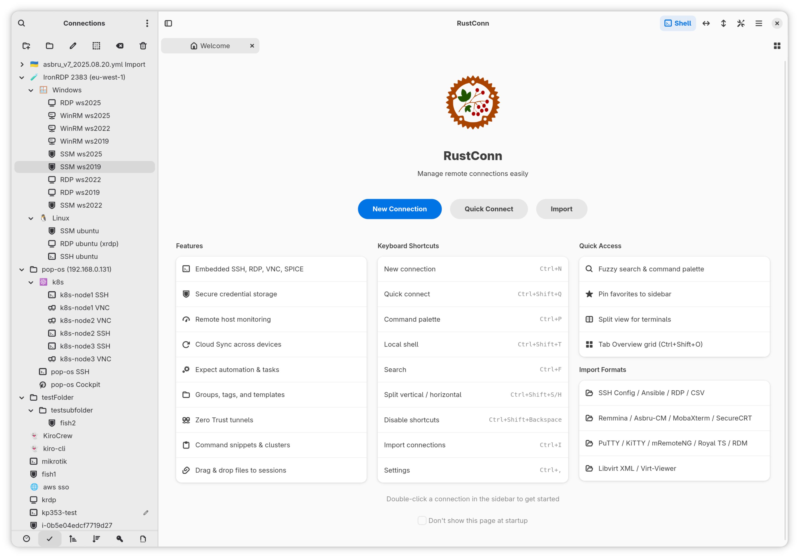
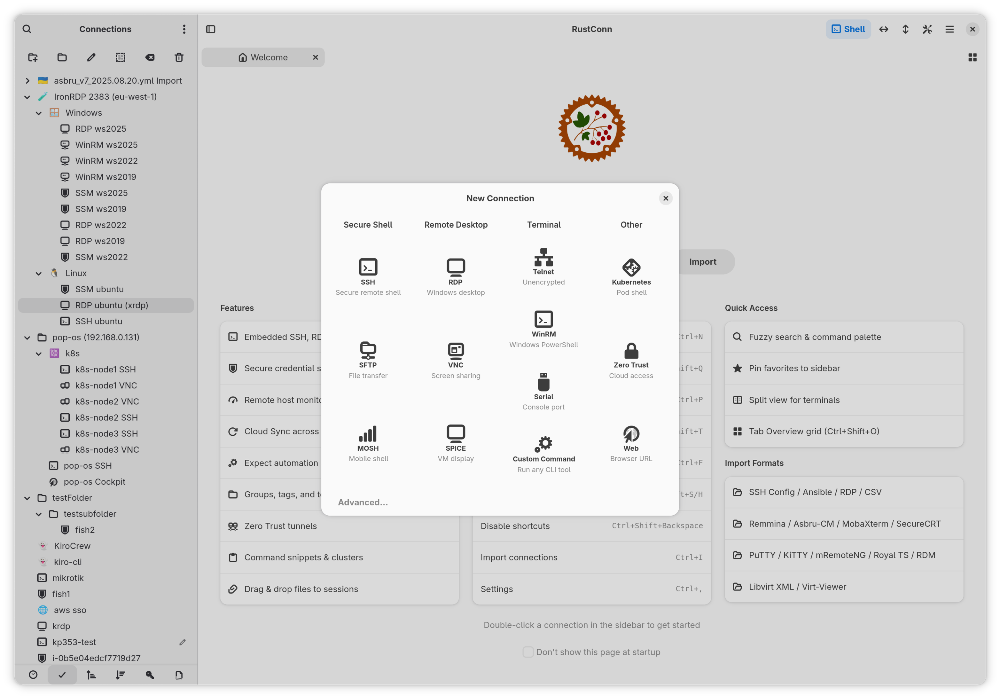
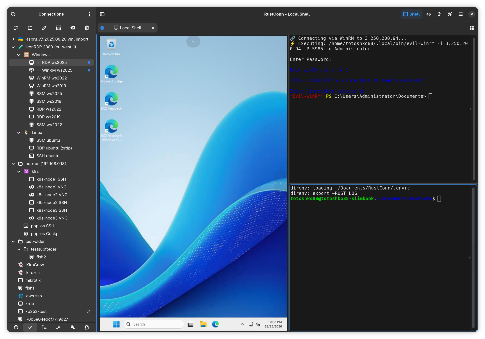
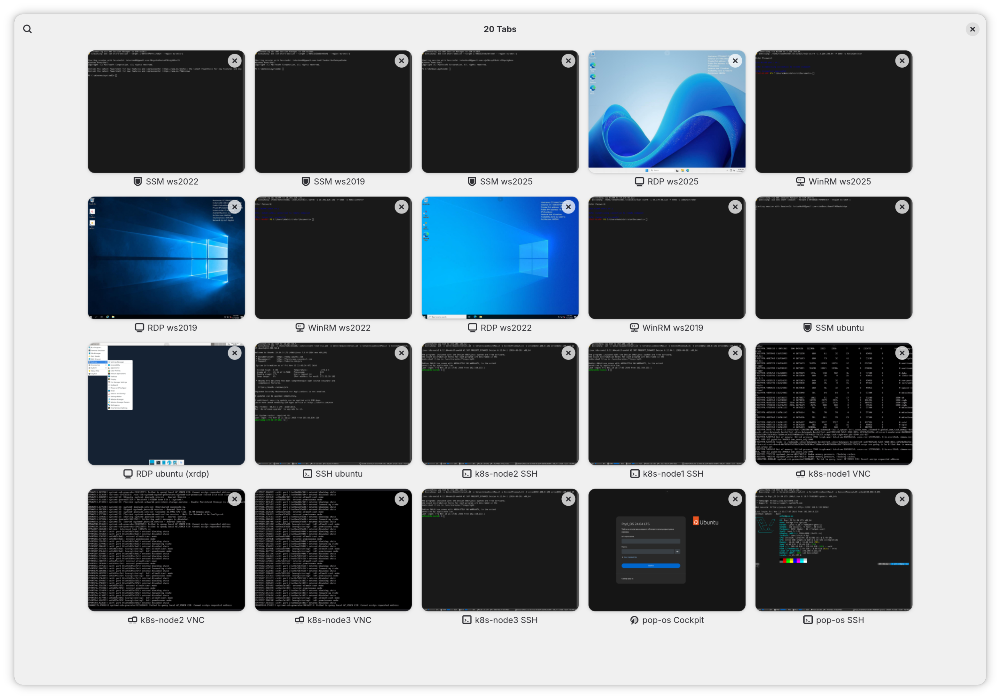
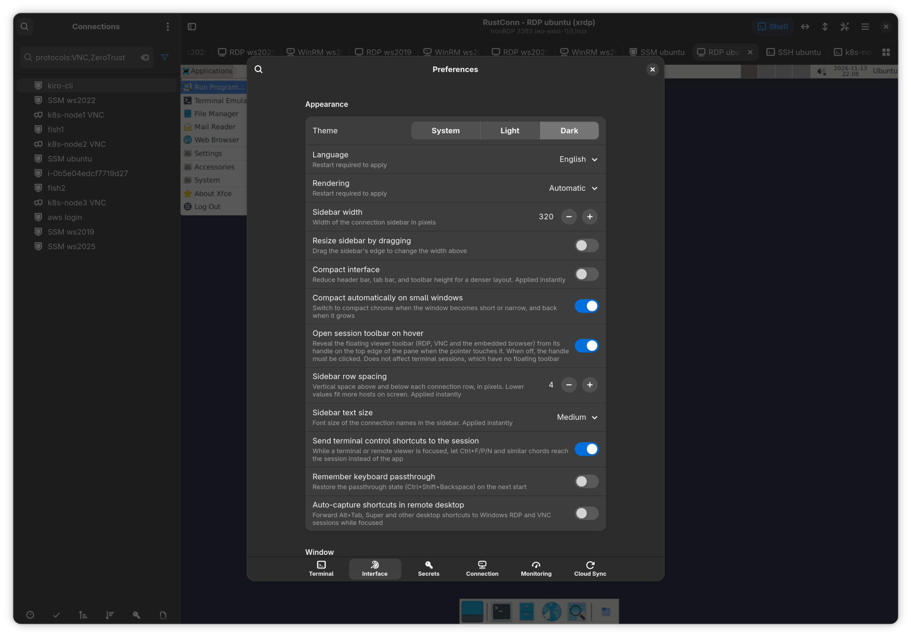

  

<h1 align="center">RustConnRu</h1>

  Modern connection manager — SSH, RDP, VNC, SPICE, and more

  
  

---

> [!NOTE]
> Данный форк отличается от [RustConn](https://github.com/totoshko88/RustConn) только наличием русской локализации, которую автор апстрима по религиозным причинам отказывается добавлять.
> Никаких функциональных изменений в код приложения не вносилось.

Russian localization and fork maintenance: zbndev

RustConnRu is a connection manager with Russian localization, forked from RustConn, with a GTK4/libadwaita interface.
It brings SSH, RDP, VNC, SPICE, MOSH, Telnet, Serial, Kubernetes, and Zero Trust connections under one roof — with embedded Rust clients where possible and seamless integration with external tools where needed.
Runs on Linux (GTK4/libadwaita), macOS, FreeBSD, and Windows via WSLg.

  

## Screenshots

| | |
|---|---|
|  |  |
|  |  |
|  |  |
|  |  |

More upstream screenshots are available on the [original Flathub listing](https://flathub.org/apps/io.github.totoshko88.RustConn).

## Features

### Capabilities

| Category | Details |
|----------|---------|
| **File Transfer** | SFTP file browser via system file manager (sftp:// URI, D-Bus portal) |
| **Organization** | Groups, tags, templates, custom icons (emoji/GTK), connection history & statistics |
| **Monitoring** | Remote host metrics bar (CPU, RAM, disk, network, load, system info) — agentless, per-connection toggle |
| **Import** | Asbru-CM, Remmina, SSH config, Ansible inventory, Royal TS, MobaXterm, SecureCRT, PuTTY/KiTTY (.reg), mRemoteNG (confCons.xml), Remote Desktop Manager, RDP files (.rdp), virt-viewer (.vv), libvirt (XML + daemon), CSV, native (.rcn) |
| **Export** | Asbru-CM, Remmina, SSH config, Ansible inventory, Royal TS, MobaXterm, SecureCRT, CSV, RDP files (.rdp), native (.rcn) — passwords are never exported |
| **Security** | KeePassXC (KDBX), libsecret, macOS Keychain, Bitwarden CLI, 1Password CLI, Passbolt CLI, Pass (passwordstore.org), script credentials; encrypted-file fallback with no keyring required (machine-bound or a portable file for use across machines); hardware-token SSH auth (FIDO2 security keys, PKCS#11 / YubiKey / smart cards); FIDO2 passkey redirection for RDP sessions |
| **Terminal** | Split terminals, command snippets, text highlighting rules, session recording, custom terminal themes, tab overview, tab pinning, OSC 133 shell integration (prompt navigation + failed-command marker) |
| **Session Windows** | Move any session (SSH, Telnet, Serial, Kubernetes, MOSH, Zero Trust, embedded RDP/VNC/Web) to its own window and back with `Ctrl+Shift+M` — per-monitor fullscreen, never reconnects |
| **Automation** | Expect rules, key sequences, pre/post-connect tasks, elevated credentials (sudo/su injection), output filters (ChromaTerm), cluster & ad-hoc broadcast, session reconnect, Wake-on-LAN |
| **Networking** | Jump hosts (bastions) picked per connection, per group, or as a global default — honoured by SSH, SFTP, RDP, VNC, and SPICE, with multi-hop chains and a per-connection Direct override; **Open Browser via Tunnel** — one right-click on an SSH host raises a SOCKS proxy and opens a browser (embedded or external Chromium) routed through it, to reach host-only web UIs; Multipath TCP for mobility & bandwidth aggregation (SSH/RDP/VNC), network-change auto-reconnect, port knocking, fwknop SPA; one-click QUIC (quicssh) ProxyCommand preset for SSH over QUIC (connection migration and UDP NAT traversal; quicssh installed separately) |
| **Workflow** | Smart folders, SSH port forwarding, visual SSH tunnel builder, workspace profiles (save/restore open sessions, including split layout and divider ratio), settings backup/restore, .rdp file association |
| **Cloud Sync** | Synchronize connections via shared cloud directory (Google Drive, Syncthing, Nextcloud, Dropbox); group sync with Master/Import access model; simple sync with UUID-based merge |
| **CLI** | `rustconn-cli` — headless management: list/add/update/delete connections, import/export, snippets, groups, templates, clusters, WoL, shell completions; optional secret and client-launch commands behind features |
| **Languages** | English, plus translations into Azerbaijani, Belarusian, Czech, Danish, German, Spanish, French, Italian, Georgian, Kazakh, Dutch, Polish, Portuguese, Russian, Slovak, Swedish, Ukrainian, Uzbek, Vietnamese and Simplified Chinese |

### Protocol support

| Protocol | Client | Type |
|----------|--------|------|
| SSH | VTE terminal (port forwarding: -L/-R/-D) | Embedded |
| RDP | IronRDP / FreeRDP fallback (bundled in Flatpak) | Embedded + external |
| VNC | vnc-rs / vncviewer fallback | Embedded + external |
| SPICE | remote-viewer / virt-viewer | External |
| Telnet | VTE terminal | Embedded |
| WinRM | VTE terminal, external `evil-winrm` | Embedded |
| Serial | picocom via VTE | External (bundled in Flatpak) |
| Kubernetes | kubectl exec via VTE | External |
| MOSH | mosh via VTE | External |
| Zero Trust | AWS SSM, GCP IAP, Azure Bastion, Azure SSH (AAD), OCI, Cloudflare, Teleport, Tailscale, Boundary, Hoop.dev | External |
| Web | Embedded WebKitGTK 6.0 browser (Linux) / System browser / Custom browser command | Embedded + external |

## Installation

| Method | Command / Link |
|--------|---------------|
| **AppImage** | [Releases](https://github.com/zbndev/RustConn-ru/releases) |
| **Debian/Ubuntu (.deb)** | [Releases](https://github.com/zbndev/RustConn-ru/releases) |
| **Fedora (.rpm)** | [Releases](https://github.com/zbndev/RustConn-ru/releases) |
| **Flatpak file (.flatpak)** | [Releases](https://github.com/zbndev/RustConn-ru/releases) |
| **Arch Linux (AUR)** | `yay -S rustconn-ru` |
| **From source** | Rust 1.95+, GTK4 4.14+ ([build guide](docs/BUILD.md)); use this fork's source |

Use the installation commands included in the fork's release notes. The original
Flathub, Snap, OBS, Homebrew and `rustconn` AUR packages do not contain this fork's
Russian translation. Installed binary names and the application ID remain
unchanged; the fork is not intended for parallel installation alongside upstream.

Files attached to a GitHub release carry a signed build-provenance attestation —
verify a download with
`gh attestation verify <file> --repo zbndev/RustConn-ru`
([details](docs/CI_BUILD_FLOW.md#артефакты)).

Keyboard shortcuts are customizable in Settings → Keybindings; press `Ctrl+?`
in the app for the complete, always-current list.

### Upstream sources (reference)

These channels distribute the original RustConn, not this Russian-localized fork:

| Channel | Where |
|---------|-------|
| GitHub Releases | [totoshko88/RustConn releases](https://github.com/totoshko88/RustConn/releases); the deb, rpm, AppImage and Flatpak files carry a build-provenance attestation |
| Flathub | [`io.github.totoshko88.RustConn`](https://flathub.org/apps/io.github.totoshko88.RustConn) |
| Snap Store | [`rustconn`](https://snapcraft.io/rustconn) |
| openSUSE Build Service | [`home:totoshko88:rustconn`](https://build.opensuse.org/package/show/home:totoshko88:rustconn/rustconn): Debian, Ubuntu, openSUSE and Fedora repositories |
| Homebrew tap | `totoshko88/rustconn` |
| AUR | [`rustconn`](https://aur.archlinux.org/packages/rustconn) (community-maintained) |
| FreeBSD ports | [`net/rustconn`](https://www.freshports.org/net/rustconn/) (community-maintained) |
| Nix flake | `github:totoshko88/RustConn` |

This fork is not affiliated with upstream RustConn. Report fork-specific issues
to [zbndev/RustConn-ru](https://github.com/zbndev/RustConn-ru/issues).
The upstream issue tracker covers the original builds and downstream
distribution packages, not this fork.

## Documentation

| Document | Description |
|----------|-------------|
| [User Guide](docs/USER_GUIDE.md) | Complete usage documentation |
| [Installation](docs/INSTALL.md) | All installation methods and repository setup |
| [Build Guide](docs/BUILD.md) | Building from source, feature flags, per-distro prerequisites |
| [macOS Build](docs/MACOS_BUILD.md) | Building and running on macOS, Homebrew, DMG packaging |
| [Windows / WSL2](docs/WSL.md) | Running RustConn on Windows via WSLg |
| [CLI Reference](docs/CLI_REFERENCE.md) | `rustconn-cli` commands and examples |
| [Architecture](docs/ARCHITECTURE.md) | Crate structure and design decisions |
| [CI & Build Flow](docs/CI_BUILD_FLOW.md) | Manual upstream review, CI checks, four-format builds and draft releases |
| [Zero Trust](docs/ZERO_TRUST.md) | Setup guides for each supported Zero Trust provider |
| [Changelog](CHANGELOG.md) | Release history and notable changes |

## Contributing

[CONTRIBUTING.md](CONTRIBUTING.md) covers development setup, the quality gate,
and the conventions a pull request is checked against. Participation is under the
[Code of Conduct](#code-of-conduct).

- **Bugs and features** — [issue tracker](https://github.com/zbndev/RustConn-ru/issues);
  the forms ask for the version, install method, and desktop, which is usually
  what a diagnosis turns on.
- **Questions** — [Discussions](https://github.com/totoshko88/RustConn/discussions).
- **Code** — see the [Build Guide](docs/BUILD.md) and
  [Architecture](docs/ARCHITECTURE.md) to get started.
- **Translations** — RustConn ships every catalogue listed in
  [`po/LINGUAS`](po/LINGUAS); the `.po` files live in [`po/`](po/). New
  languages and corrections are appreciated; which languages the project
  ships is in [CONTRIBUTING.md](CONTRIBUTING.md#translations).
- **Vulnerabilities** — privately, via
  [Security Advisories](https://github.com/totoshko88/RustConn/security/advisories/new)
  rather than an issue ([SECURITY.md](SECURITY.md)).

## Code of Conduct

RustConn follows the [GNOME Code of Conduct](https://conduct.gnome.org/).
It applies to everyone taking part in the project's issues, pull requests,
discussions and code review. To report a problem, write to the maintainer at
totoshko88@gmail.com or contact the
[GNOME Code of Conduct Committee](https://conduct.gnome.org/reporter-guide/).
See [CODE_OF_CONDUCT.md](CODE_OF_CONDUCT.md) for details.

## License

GPL-3.0-or-later — Made with ❤️

From release 0.24.11, the author's own material carries additional terms under
GPL-3.0 section 7 (author attribution, the origin of modified versions, and the
use of the name), set out in [NOTICE](NOTICE).
