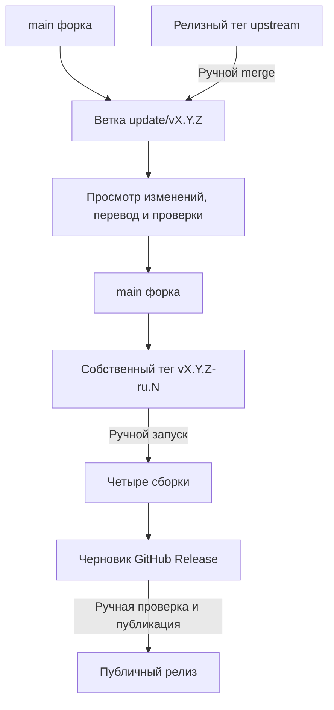

# Ручное обновление и выпуск RustConn-ru

В этом форке **все GitHub Actions workflows запускаются только вручную**.
Push ветки или тега, pull request и расписание не запускают сборку или публикацию.
Синхронизации с upstream, автоматического merge и публичной публикации нет.

## Ветки и теги

- `origin` — `https://github.com/zbndev/RustConn-ru.git`.
- `upstream` — `https://github.com/totoshko88/RustConn.git`.
- `main` — проверенный код форка вместе с русским переводом и его workflows.
- `update/vX.Y.Z` — временная ветка для просмотра очередного релиза upstream.
- `vX.Y.Z-ru.N` — собственный тег выпуска форка; `N` начинается с 1.

Релиз собирается **из коммита собственного тега**, а не из меняющейся ветки
`main`. Версия `X.Y.Z` должна совпадать с `workspace.package.version` в
`Cargo.toml`. Исправление перевода для той же исходной версии получает следующий
номер `ru.N`; версию Rust workspace ради этого менять не нужно.
Не перемещай уже выпущенные теги.

Номер `ru.N` используется только в теге: имена файлов и версии устанавливаемых
пакетов остаются как у upstream. Повторный выпуск той же исходной версии поэтому
не считается новой версией пакета; для его установки может потребоваться явная
переустановка.



## Первичная настройка

1. Сначала проверь и закоммить изменения форка. Локализация, workflows и
   `scripts/manual-release.py` должны входить в коммит, который будет отмечен
   релизным тегом. Не включай чужие незавершённые изменения.
2. Загрузи проверенные коммиты в свой репозиторий. Сам push ничего не запускает.
3. На вкладке **Actions** своего форка явно включи workflows, если GitHub
   отключил их при создании форка.
4. Для команд ниже нужен авторизованный GitHub CLI (`gh`). Workflows используют
   только встроенный `GITHUB_TOKEN`; PAT, OBS, Snap Store и Homebrew secrets не
   нужны.
5. Проверь отдельные настройки GitHub: default CodeQL setup, GitHub Apps и
   внешние интеграции могут иметь собственные триггеры, не управляемые файлами
   этого репозитория. Для workflow `codeql.yml` default CodeQL setup должен быть
   выключен, иначе GitHub отвергает результаты advanced setup.

Удалённый репозиторий upstream добавляется один раз:

```bash
git remote add upstream https://github.com/totoshko88/RustConn.git
```

Не используй **Sync fork** вслепую: он синхронизирует ветку upstream, а здесь
обновления принимаются по конкретному релизному тегу после просмотра.

## Ручное принятие обновления upstream

Пример ниже использует `v0.24.10`; подставь действительно выпущенный тег.
Начинай с чистого рабочего дерева и своего проверенного `main`.

```bash
UPSTREAM_TAG=v0.24.10
git fetch --no-tags upstream "refs/tags/${UPSTREAM_TAG}:refs/tags/upstream/${UPSTREAM_TAG}"
git switch main
git switch -c "update/${UPSTREAM_TAG}"
git merge --no-ff --no-commit "refs/tags/upstream/${UPSTREAM_TAG}"
```

Fetch загружает Git-объекты, но не запускает код программы. Merge может потребовать
ручного разрешения конфликтов. До просмотра результата **не запускай скрипты,
Cargo, IDE-задачи сборки и CI**: `build.rs` и процедурные макросы исполняются уже
во время сборки. Просмотри весь diff, в том числе изменения, добавленные при
разрешении конфликтов:

```bash
git diff --cached --stat
git diff --cached
git diff
```

Особое внимание:

- `.github/`: триггеры, права токенов, actions, источники checkout и публикация;
- `Cargo.toml`, `Cargo.lock`, `.cargo/`, `rust-toolchain.toml`, `build.rs` и
  процедурные макросы;
- `scripts/`, `packaging/`, команды загрузки и запуска внешних программ;
- обработка паролей, ключей, подключений и сетевых запросов.

Сохрани ручные триггеры форка и его русскую локаль. Автоматическое разрешение
конфликтов через `ours`/`theirs` не заменяет просмотр изменений.
После просмотра обнови русский каталог и переведи новые или fuzzy-сообщения:

```bash
bash po/update-pot.sh
msgmerge --update --backup=none po/ru.po po/rustconn.pot
msgcmp po/ru.po po/rustconn.pot
scripts/check-po-complete.sh ru
```

Затем выполни проверки и проверь интерфейс. Закоммить просмотренный результат,
при необходимости запусти CI вручную для этой ветки, и только после проверки
объедини её со своим `main`. Для первого выпуска уже подготовленной локализации
повторно объединять тот же upstream-тег не требуется.

## Проверки вручную

`ci.yml` проверяет форматирование, clippy, тесты, границы крейтов, локализацию,
зависимости и feature-комбинации. Он не создаёт релиз и больше не собирает
Homebrew-пакет из исходников оригинального репозитория.

После просмотра кода CI можно запустить для своей ветки:

```bash
gh workflow run ci.yml --repo zbndev/RustConn-ru --ref main
```

`codeql.yml` также запускается только вручную. Учти, что Rust-анализатор может
исполнять build scripts и proc macros; это не безопасный способ впервые
посмотреть непроверенный код.

`flatpak.yml` — отдельная ручная пробная сборка выбранного коммита форка, без
создания релиза. `check-cli-versions.yml` — ручная проверка версий внешних CLI;
при найденных обновлениях существующий workflow может создать или обновить issue
и требует включённых Issues в настройках репозитория.

## Подготовка и запуск выпуска

В примере — первый выпуск форка для исходной версии `0.24.9`. Убедись, что `main`
содержит все просмотренные изменения и русский перевод; команды ниже выполняет
сопровождающий, не агент:

```bash
git switch main
git tag -a v0.24.9-ru.1 -m "RustConn-ru v0.24.9-ru.1"
git push origin main
git push origin refs/tags/v0.24.9-ru.1
gh workflow run release.yml --repo zbndev/RustConn-ru --ref v0.24.9-ru.1
```

Workflow необходимо запускать **от тега**, не от `main`. Запуск от ветки, чужой
формат тега, несовпадение версии или коммита и отсутствие русского каталога
останавливают выпуск. Все checkout закреплены за SHA события; перенос или
удаление тега во время сборки проверяется ещё раз перед созданием черновика.

Сборки выполняются с read-only токенами и без сохраняемых Git credentials.
Только заключительный job получает права создания релиза и аттестаций; Rust и
упаковочные инструменты в нём не запускаются. Для продукта используется
`cargo --locked`, а перед сборкой проверяются полнота и корректность русского
каталога.

### Артефакты

Для `v0.24.9-ru.1` выпускаются:

| Формат | Файл | Сборочная среда |
|--------|------|----------------|
| DEB | `rustconn_0.24.9_amd64.deb` | Ubuntu 24.04, x86_64 |
| RPM | `rustconn-0.24.9-1.x86_64.rpm` | Fedora 44, x86_64 |
| AppImage | `RustConn-0.24.9-x86_64.AppImage` | Ubuntu 24.04, x86_64 |
| Flatpak | `RustConn-0.24.9.flatpak` | GNOME runtime, x86_64 |

`SHA256SUMS` содержит хеши ровно этих четырёх файлов. Подписанная build-provenance
аттестация относится к коммиту тега форка. Она подтверждает происхождение сборки,
**не безопасность кода**. Сами пакеты сохраняют имя `rustconn`, имена исполняемых
файлов, app-id и пути конфигурации upstream; параллельная установка не обещается.
AUR-пакет `rustconn-ru` сопровождается отдельно и этим workflow не публикуется.

Flatpak-манифест перед сборкой получает URL собственного репозитория и точный
SHA выбранного коммита. Исходники RustConn не скачиваются из оригинального
репозитория и не выбираются по его перемещаемой ветке или тегу. Остальные
зависимости остаются описанными в просмотренном манифесте и `Cargo.lock`.
Эта же операция используется в отдельном `flatpak.yml`.

### Черновик и публикация

Черновик создаётся только после успешной сборки всех четырёх форматов. Его
описание включает инструкции установки форка, проверки хешей и исходное
описание upstream-релиза. Текст upstream скачивается через API как данные:
он не исполняется. Он явно помечен как описание оригинала, чьи команды установки
могут вести на оригинальные пакеты, а не на форк.

Перед публичной публикацией:

1. Скачай пакеты из черновика и проверь `sha256sum -c SHA256SUMS`.
2. Проверь установку и запуск, русский интерфейс и нужные тебе протоколы.
3. Просмотри описание релиза, особенно команды и ссылки из upstream-текста.
4. Сам нажми **Publish release** в GitHub.

Повторный запуск не перезаписывает существующий релиз или его файлы. Если
черновик уже создан, проверь его состояние вручную. Для изменённого исходного
кода создай следующий тег `ru.N`, а не переноси старый.

Snap, OBS, Homebrew и публикация на Flathub исключены из workflows; их
публикующие workflows и старые вспомогательные скрипты удалены. Остальные
upstream packaging-файлы оставлены как справочный материал для сопровождения
форка, но не являются активными каналами распространения RustConn-ru.

## Границы защиты

Ручной просмотр не доказывает отсутствие вредоносных изменений. Сборка всё ещё
загружает зависимости, системные пакеты, контейнеры и внешние инструменты;
`--locked` фиксирует выбор Cargo-зависимостей, но не делает сборку герметичной.
В частности, унаследованный linuxdeploy загружается из его `continuous` release;
проверка ELF-формата не является проверкой подлинности. Проверяй изменения всей
сборочной цепочки и не добавляй лишние secrets в jobs сборки.
